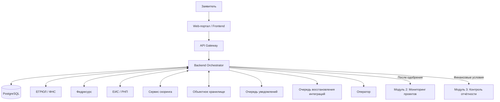

# ГИС «Господдержка» — Автоматизация распределения государственной поддержки

<p align="center">
  <strong>System Analysis · Requirements Engineering · API Design · Data Modeling</strong>
</p>

<p align="center">
  
  
  
  
</p>

## Содержание

- [О проекте](#о-проекте)
- [Цель проекта](#цель-проекта)
- [Основные возможности](#основные-возможности)
- [Бизнес-правила](#бизнес-правила)
- [Архитектура решения](#архитектура-решения)
- [Документация проекта](#документация-проекта)
  - [Требования](#требования)
  - [Диаграммы](#диаграммы)
  - [API](#api)
  - [Модель данных](#модель-данных)
  - [Тестирование](#тестирование)
  - [Тестовые данные](#тестовые-данные)
- [Связи между требованиями](#связи-между-требованиями)
- [Технологический стек](#технологический-стек)
- [Статус проекта и ограничения](#статус-проекта-и-ограничения)
- [Документация проекта](#документация-проекта)


## 1. О проекте

**ГИС «Господдержка»** — учебный проект по системному анализу информационной системы для автоматизации приёма, проверки и рассмотрения заявок промышленных предприятий на получение государственной поддержки.

Проект охватывает полный цикл подготовки аналитической документации: от бизнес-требований и правил принятия решений до REST API, модели данных PostgreSQL, диаграмм взаимодействия и тест-кейсов.

В качестве условного заказчика рассматривается Министерство промышленности и торговли РФ. Система проектируется как Модуль 1 экосистемы, в которой одобренные проекты передаются в смежные модули мониторинга и контроля отчётности.

> **Статус проекта:** учебное проектное решение. Бизнес-правила, внешние интеграции и показатели эффективности являются допущениями сценария, а не подтверждёнными характеристиками действующей государственной информационной системы.

## 2. Бизнес-задача

Предполагается, что текущая обработка заявок требует значительных ручных усилий при проверке документов, сведений о юридическом лице и финансовых показателей предприятия.

Цель проектирования — сократить ручные операции, повысить прозрачность процесса и обеспечить управляемый маршрут заявки от подачи до окончательного решения.

### Целевые показатели

| Показатель | Исходное допущение | Целевое значение |
|---|---:|---:|
| Срок обработки заявки | 14 рабочих дней | До 2 часов |
| Автозаполнение формы по ИНН | Ручное заполнение | Цель — 70% полей |
| Время ответа синхронных API | Определяется испытаниями | p95 менее 1,5 секунды |
| Доступность Модуля 1 | Определяется испытаниями | Цель — 99,9% |

Указанные значения используются как проектные KPI. Их достижение не подтверждено промышленными испытаниями. Доступность внешних сервисов рассматривается отдельно от доступности самого Модуля 1.

## 3. Архитектурный контекст

Система состоит из нескольких логических компонентов, которые совместно обеспечивают обработку заявки.



### Роли и системы

| Участник | Ответственность |
|---|---|
| Заявитель | Создание заявки, заполнение данных, загрузка документов, отслеживание статуса |
| API Gateway | Приём API-запросов, маршрутизация к серверным компонентам |
| Backend Orchestrator | Управление жизненным циклом заявки, проверки бизнес-правил, скоринг и интеграции |
| PostgreSQL | Хранение заявок, проверок, решений, аудита и технических состояний |
| Внешние реестры | Предоставление юридических и финансовых сведений |
| Сервис скоринга | Расчёт балла и формирование рекомендации |
| Оператор | Рассмотрение заявки и принятие окончательного решения |
| Модуль 2 | Мониторинг реализации одобренных проектов |
| Модуль 3 | Контроль финансовых условий и отчётности |

## 4. Сквозной процесс обработки заявки

1. Заявитель вводит ИНН предприятия.
2. Система получает доступные сведения из ЕГРЮЛ и предлагает предзаполненную форму.
3. Заявитель создаёт черновик, заполняет данные проекта и прикрепляет необходимые документы.
4. После отправки система проверяет обязательные поля, сумму заявки и применимые бизнес-ограничения.
5. Оркестратор запускает проверки по внешним источникам.
6. При успешном завершении обязательных проверок и отсутствии стоп-факторов система запрашивает скоринговую оценку.
7. По результатам проверок и скоринга определяется маршрут заявки.
8. Оператор рассматривает материалы и фиксирует окончательное решение.
9. При одобрении система передаёт необходимые сведения в Модуль 2 и финансовые условия в Модуль 3.
10. Результаты проверок, решения, изменения статусов и технические ошибки сохраняются для последующего аудита.

### Статусы заявки

| Статус | Назначение |
|---|---|
| `DRAFT` | Черновик |
| `SUBMITTED` | Заявка отправлена |
| `DATA_CHECK` | Выполняются автоматические проверки |
| `NEEDS_REVISION` | Заявка возвращена на доработку |
| `UNDER_REVIEW` | Заявка рассматривается оператором |
| `APPROVED` | Заявка одобрена |
| `REJECTED` | Заявка отклонена |

**Статус заявки и рекомендация скоринга — разные сущности.** Рекомендации `APPROVE`, `MANUAL_REVIEW` и `REJECT` не заменяют бизнес-статус и сами по себе не означают окончательное решение оператора.

## 5. Бизнес-правила

### 5.1. Валидация

| Код | Правило | Ожидаемое поведение |
|---|---|---|
| `BR-VAL-01` | ИНН должен содержать 10 цифр и проходить проверку контрольного числа | Некорректное значение отклоняется до запроса сведений о предприятии |
| `BR-VAL-02` | Сумма заявки должна быть больше нуля и не превышать 500 млн рублей | Нарушение диапазона блокирует отправку |
| `BR-VAL-03` | Основной ОКВЭД должен соответствовать отраслевым условиям учебной программы | Несоответствие приводит к ошибке бизнес-валидации |

### 5.2. Стоп-факторы

| Код | Критерий учебного сценария |
|---|---|
| `BR-STOP-01` | Налоговая задолженность строго больше 50 000 рублей |
| `BR-STOP-02` | Юридический статус исключает участие по правилам сценария |
| `BR-STOP-03` | Предприятие обнаружено в РНП |
| `BR-STOP-04` | Обнаружена процедура банкротства, признаваемая стоп-фактором |
| `BR-STOP-05` | Срок существования юридического лица менее 12 месяцев |

### 5.3. Маршрутизация по скорингу

| Код | Скоринговый балл | Рекомендация |
|---|---:|---|
| `BR-SCORE-01` | 0–59 | `REJECT` |
| `BR-SCORE-02` | 60–79 | `MANUAL_REVIEW` |
| `BR-SCORE-03` | 80–100 | `APPROVE` |

Стоп-факторы имеют приоритет перед результатом скоринга в рамках учебного сценария. Ошибка или отсутствие ответа внешнего сервиса не считаются отрицательным результатом проверки.

Все перечисленные критерии необходимо подтверждать регламентом конкретной программы перед использованием в реальной системе.

## 6. Навигация по документации

Репозиторий организован по принципу **Docs-as-Code**: документы, схемы, спецификации и примеры данных хранятся рядом и версионируются в Git.

```text
.
├── README.md
├── docs/
│   ├── 01-requirements/
│   │   ├── business-requirements.md
│   │   ├── business-rules.md
│   │   ├── use-cases.md
│   │   └── system-requirements.md
│   │
│   ├── 02-diagrams/
│   │   ├── bpmn-process.puml
│   │   ├── bpmn-process.svg
│   │   └── sequence-diagram.md
│   │
│   ├── 03-api/
│   │   ├── openapi.yaml
│   │   └── mock-data/
│   │       ├── application-payload.json
│   │       ├── fns-response.json
│   │       └── scoring-response.json
│   │
│   ├── 04-db/
│   │   ├── erd.md
│   │   └── schema.sql
│   │
│   └── 05-testing/
│       └── test-cases.md
│
└── Defense_Presentation_Gospodderzhka.pptx
```

### Требования и сценарии

| Документ | Содержание |
|---|---|
| [Business Requirements](docs/01-requirements/business-requirements.md) | Бизнес-проблема, цели, KPI, стейкхолдеры, Scope и Out of Scope |
| [Business Rules](docs/01-requirements/business-rules.md) | Валидация, стоп-факторы, диапазоны скоринга, обработка ошибок |
| [Use Cases](docs/01-requirements/use-cases.md) | Сценарии подачи, проверки и рассмотрения заявки |
| [System Requirements](docs/01-requirements/system-requirements.md) | Функциональные и нефункциональные требования, безопасность, производительность и аудит |

### Диаграммы

| Документ | Содержание |
|---|---|
| [Process Diagram — PlantUML](docs/02-diagrams/bpmn-process.puml) | Схема бизнес-процесса TO-BE |
| [Process Diagram — SVG](docs/02-diagrams/bpmn-process.svg) | Визуальный экспорт схемы процесса |
| [Sequence Diagram](docs/02-diagrams/sequence-diagram.md) | Взаимодействие API, оркестратора, БД, внешних сервисов и смежных модулей |

> `bpmn-process.puml` — диаграмма процесса, записанная в синтаксисе PlantUML. Это не BPMN 2.0 XML-модель. Формальный BPMN-артефакт можно добавить отдельно, если этого требует формат сдачи проекта.

### API и база данных

| Документ | Содержание |
|---|---|
| [OpenAPI Specification](docs/03-api/openapi.yaml) | Контракты REST API, модели запросов и ответов, статусы и ошибки |
| [Application Payload](docs/03-api/mock-data/application-payload.json) | Пример данных для создания заявки |
| [FNS Response](docs/03-api/mock-data/fns-response.json) | Пример ответа внешнего реестра |
| [Scoring Response](docs/03-api/mock-data/scoring-response.json) | Пример результата скоринговой оценки |
| [ER Diagram](docs/04-db/erd.md) | Сущности, атрибуты и связи |
| [Database Schema](docs/04-db/schema.sql) | DDL-скрипт PostgreSQL, ограничения, индексы и технические таблицы |

### Тестирование

[**Test Cases](docs/05-testing/test-cases.md)** описывает позитивные, негативные, граничные, интеграционные, security- и performance-сценарии.

Наличие тест-кейсов не означает, что тестирование уже выполнено: результаты выполнения должны фиксироваться отдельно.

## 7. Requirements Mapping — матрица трассируемости

Матрица связывает требования с их реализацией и проверкой. Она помогает определить, какие артефакты необходимо обновить при изменении бизнес-правил.

| Требование / сценарий | Бизнес-правило или UC | Системные требования | API | Данные БД | Тесты |
|---|---|---|---|---|---|
| Проверка ИНН | `BR-VAL-01`, UC-01 | `FR-002`, `FR-003` | `GET /companies/suggest` | `COMPANIES` | `TC-VAL-001–003` |
| Валидация суммы | `BR-VAL-02`, UC-01 | `FR-004` | Создание и отправка заявки | `APPLICATIONS` | `TC-VAL-009–012` |
| Проверка ОКВЭД | `BR-VAL-03`, UC-01 | `FR-004`, `FR-010` | Получение данных предприятия и отправка заявки | `COMPANIES`, `APPLICATIONS`, `APPLICATION_CHECKS` | `TC-VAL-013–015` |
| Стоп-факторы | `BR-STOP-01–05`, UC-02 | `FR-009–014` | Интеграционные вызовы; `GET /applications/{id}/checks` | `APPLICATION_CHECKS`, `COMPANY_FINANCIAL_SNAPSHOTS` | `TC-CHK-001–009` |
| Скоринг | `BR-SCORE-01–03`, UC-02 | `FR-015–018`, `FR-045` | `GET /applications/{id}/scoring` | `SCORING_RESULTS` | `TC-SCR-001–008` |
| Черновик и редактирование | UC-01 | `FR-001`, `FR-038`, `FR-039` | `POST /applications/drafts`, `PATCH /applications/{id}` | `APPLICATIONS`, `APPLICATION_CONTACTS` | `TC-LC-001–007` |
| Документы | UC-01 | `FR-040`, `FR-041` | `/applications/{id}/documents` | `APPLICATION_DOCUMENTS` | `TC-DOC-001–010` |
| Отправка и повторная подача | UC-01, UC-03 | `FR-005–008`, `FR-031` | `POST /applications/{id}/submit`, `POST /applications/{id}/resubmit` | `APPLICATIONS`, `APPLICATION_STATUS_HISTORY` | `TC-LC-008–014` |
| Решение оператора | UC-03 | `FR-024–032` | `POST /applications/{id}/decision` | `DECISIONS`, `APPLICATIONS`, `APPLICATION_STATUS_HISTORY`, `AUDIT_EVENTS` | `TC-DEC-001–010` |
| Идемпотентность | UC-01, UC-03 | `FR-006`, `FR-042` | Операции изменения состояния с `Idempotency-Key` | `IDEMPOTENCY_RECORDS` | `TC-INT-001–002` |
| Ошибки интеграций | UC-02, UC-03 | `FR-019–023`, `FR-036–044` | API и внутренние интеграционные контракты | `APPLICATION_CHECKS`, `INTEGRATION_DELIVERIES` | `TC-INT-003–010` |
| Уведомления | UC-01, UC-03 | `FR-032`, `NFR-AV-02` | Операции, изменяющие статус | `NOTIFICATION_OUTBOX` | `TC-INT-009–010` |
| Безопасность и аудит | Все UC | `FR-029–030`, `NFR-SEC-*`, `NFR-AUD-*` | Все защищённые операции | `AUDIT_EVENTS` и связанные таблицы | `TC-SEC-001–007`, `TC-DB-006` |
| Производительность и доступность | Бизнес-цели | `NFR-PERF-*`, `NFR-AV-*` | Синхронные API и интеграции | Метрики и журналы | `TC-NFR-001–007` |

**Правило трассируемости:** каждое бизнес-правило должно иметь соответствующее системное требование, отражение в API или модели данных там, где это необходимо, и минимум один проверяющий тест-кейс.

При изменении требования необходимо проверить все связанные строки матрицы, а не только документ, в котором изменение появилось впервые.

## 8. Модель данных

В модели PostgreSQL предусмотрены следующие основные сущности:

| Сущность | Назначение |
|---|---|
| `COMPANIES` | Профили юридических лиц |
| `COMPANY_FINANCIAL_SNAPSHOTS` | Снимки финансовых показателей из внешних источников |
| `APPLICATIONS` | Заявки, параметры проекта и текущий статус |
| `APPLICATION_CONTACTS` | Контактные данные заявителя |
| `APPLICATION_DOCUMENTS` | Метаданные прикреплённых файлов |
| `APPLICATION_CHECKS` | Результаты проверок и ошибки интеграций |
| `SCORING_RESULTS` | История скоринговых оценок |
| `DECISIONS` | Решения оператора |
| `APPLICATION_STATUS_HISTORY` | История переходов между статусами |
| `INTEGRATION_DELIVERIES` | Передача данных в Модули 2 и 3 |
| `IDEMPOTENCY_RECORDS` | Защита от дублирования запросов |
| `AUDIT_EVENTS` | Журнал значимых действий |
| `NOTIFICATION_OUTBOX` | Очередь уведомлений и результаты доставки |

Технические состояния интеграций и уведомлений хранятся отдельно от бизнес-статуса заявки. Это позволяет обрабатывать временные сбои без потери уже принятого решения.

## 9. API-контракты

Спецификация описывает следующие группы операций:

| Группа | Примеры операций |
|---|---|
| Предприятия | `GET /companies/suggest` |
| Черновики | `POST /applications/drafts` |
| Заявки | `POST /applications`, `GET /applications`, `GET /applications/{id}`, `PATCH /applications/{id}` |
| Жизненный цикл | `POST /applications/{id}/submit`, `POST /applications/{id}/resubmit` |
| Документы | `/applications/{id}/documents` и связанные операции |
| Проверки | `GET /applications/{id}/checks` |
| Скоринг | `GET /applications/{id}/scoring` |
| Решения | `POST /applications/{id}/decision` |
| История статусов | `GET /applications/{id}/status-history` |

API использует Bearer-аутентификацию. Доступ к данным заявки определяется полномочиями пользователя. Идемпотентность применяется для операций, при повторении которых может возникнуть дублирование бизнес-действий.

Подробные схемы запросов, ответов и ошибок содержатся в `docs/03-api/openapi.yaml`.

## 10. Тестирование и критерии качества

Тестовая документация охватывает:

- позитивные и негативные сценарии;
- граничные значения суммы, ИНН и скоринга;
- проверку всех предусмотренных стоп-факторов;
- управление статусами и повторную подачу;
- загрузку документов;
- авторизацию и разграничение доступа;
- идемпотентность и ошибки внешних сервисов;
- повторную передачу данных в смежные модули;
- производительность, доступность и целостность данных.

Основной критерий завершения — отсутствие открытых критических дефектов, корректное прохождение обязательных тестов и согласованность результатов с требованиями.

Результаты тестирования необходимо фиксировать отдельно от самих тест-кейсов.

## 11. Допущения и ограничения проекта

1. Проект является учебным; реальные производственные интеграции не подтверждены.
2. Внешние сервисы могут моделироваться с помощью JSON-моков.
3. Порог налоговой задолженности, минимальный срок существования юридического лица, правила по ОКВЭД и диапазоны скоринга требуют подтверждения регламентом конкретной программы.
4. Техническая ошибка внешнего источника не является самостоятельным основанием для отказа.
5. Скоринговая рекомендация не заменяет окончательное решение оператора.
6. Целевые KPI должны быть подтверждены испытаниями; в данном репозитории они являются проектными ориентирами.
7. Интеграционные таймауты и повторы должны соответствовать согласованной политике конкретного сервиса.

## 12. Технологии и подход

- **Documentation-as-Code:** Markdown и Git.
- **API contract design:** OpenAPI 3.0.3.
- **Data modeling:** ERD и PostgreSQL DDL.
- **Process and interaction modeling:** PlantUML и Mermaid.
- **Test design:** позитивные, негативные, граничные и интеграционные сценарии.
- **Traceability:** связка бизнес-правил, системных требований, API, БД и тест-кейсов.

## 13. План развития проекта

- [x] Подготовить бизнес-требования и границы проекта.
- [x] Описать бизнес-правила и сценарии использования.
- [x] Сформировать системные требования.
- [x] Подготовить диаграммы процесса и последовательности.
- [x] Спроектировать ERD и структуру PostgreSQL.
- [x] Подготовить спецификацию OpenAPI и JSON-моки.
- [x] Сформировать тест-кейсы.
- [ ] Выполнить полную структурную валидацию OpenAPI.
- [ ] Запустить SQL на тестовой PostgreSQL и проверить DDL.
- [ ] Проверить рендеринг обеих диаграмм.
- [ ] Выполнить тест-кейсы и зафиксировать результаты.
- [ ] Согласовать оставшиеся открытые вопросы по бизнес-правилам и интеграциям.

Отметки о подготовке артефактов не означают, что все технические проверки и тесты уже выполнены.

## 📚 Документация проекта

### Требования
- [Бизнес-требования (BRD)](docs/01-requirements/business-requirements.md)
- [Бизнес-правила](docs/01-requirements/business-rules.md)
- [Системные требования](docs/01-requirements/system-requirements.md)
- [Сценарии использования (Use Cases)](docs/01-requirements/use-cases.md)

### Диаграммы
- [Диаграмма бизнес-процесса PlantUML](docs/02-diagrams/bpmn-process.puml)
- [Диаграмма бизнес-процесса SVG](docs/02-diagrams/bpmn-process.svg)
- [Диаграмма последовательности Mermaid](docs/02-diagrams/sequence-diagram.md)

### API
- [OpenAPI-спецификация](openapi.yaml)

### Модель данных
- [ER-диаграмма](docs/04-data-model/erd.md)
- [SQL-схема базы данных](docs/04-data-model/schema.sql)

### Тестирование
- [Тест-кейсы](docs/05-testing/test-cases.md)

### Тестовые данные
- [Пример заявки JSON](docs/06-mocks/application-payload.json)
- [Ответ ФНС JSON](docs/06-mocks/fns-response.json)
- [Результат скоринга JSON](docs/06-mocks/scoring-response.json)

---

<p align="center">
  <sub>Учебный проект системного анализа · ГИС «Господдержка» · Модуль 1</sub>
</p>