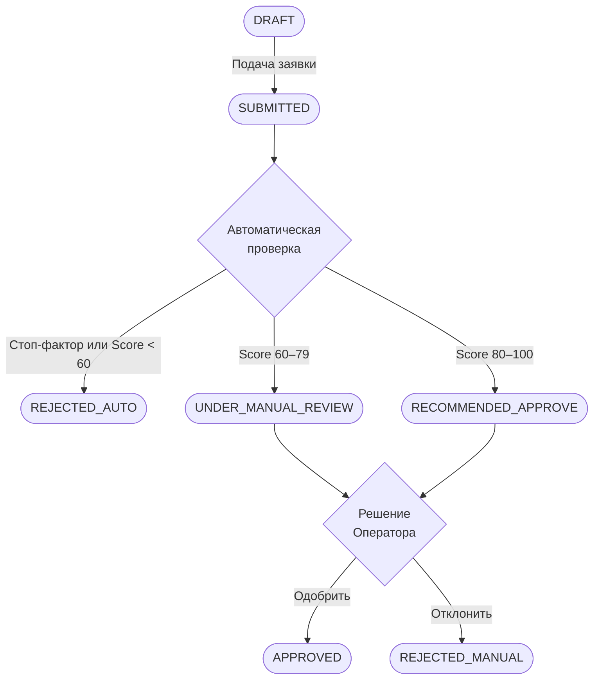

# Бизнес-правила и стоп-факторы системы

Документ описывает логику автоматической квалификации заявок, проверки требований к заявителям и правила распределения статусов.

---

## 1. Автоматические стоп-факторы (Критерии незамедлительного отказа)

Если выполняется хотя бы одно из следующих правил, заявка автоматически переводится в статус `🔴 Отклонено` без передачи на рассмотрение сотруднику.

| Код | Наименование проверки | Источник данных | Критерий срабатывания стоп-фактора | Решение / Действие системы |
| :--- | :--- | :--- | :--- | :--- |
| `BR-STOP-01` | Налоговая задолженность | API ФНС (Сведения о задолженностях) | Сумма непогашенной задолженности $> 50\ 000$ руб. | Автоматический отказ, фиксация суммы долга в протоколе. |
| `BR-STOP-02` | Юридический статус | API ЕГРЮЛ (ФНС) | Статус юрлица: *"В процессе ликвидации"*, *"Банкротство"* или *"Исключение из ЕГРЮЛ"* | Автоматический отказ. |
| `BR-STOP-03` | Реестр недобросовестных поставщиков | API ЕИС (РНП) | Наличие компании в РНП (44-ФЗ / 223-ФЗ) | Автоматический отказ. |
| `BR-STOP-04` | Процедуры банкротства | API Федресурс | Наличие открытых производств по делу о несостоятельности | Автоматический отказ. |
| `BR-STOP-05` | Срок существования юрлица | Внутренний расчет по ЕГРЮЛ | Срок регистрации компании $< 12$ месяцев на дату подачи заявки | Автоматический отказ. |

---

## 2. Логика финтех-скоринга и маршрутизации заявок

После прохождения первичных стоп-факторов система запускает расчет совокупного рейтинга компании (Scoring Score) по шкале от 0 до 100 баллов.

### Формула весов скоринга
* **Финансовая устойчивость (40%):** Коэффициент текущей ликвидноcти, рентабельность, динамика выручки за последние 3 года.
* **Кредитная история и обязательства (30%):** Наличие долговой нагрузки, исполнение предыдущих контрактов/субсидий.
* **Целевой проект модернизации (30%):** Соотношение запрашиваемой суммы к годовой выручке (не более 50% от годовой выручки).

### Матрица принятия решений по скорингу

| Диапазон баллов | Автоматический статус | Назначение в системе | Требуемые действия |
| :--- | :--- | :--- | :--- |
| **80 – 100 баллов** | 🟢 `Рекомендовано` | Дашборд Оператора | Экспресс-проверка оператором, утверждение в 1 клик. |
| **60 – 79 баллов** | 🟡 `Требует ручной проверки` | Дашборд Оператора | Расширенная проверка документов и финмодели экспертом. |
| **0 – 59 баллов** | 🔴 `Отклонено` | Не передается оператору | Автоматический отказ с указанием слабых метрик. |

---

## 3. Матрица переходов статусов заявки (State Machine)

### 4. Бизнес-правила валидации формы ввода (Frontend/Backend)

| Код | Поле формы | Правило валидации | Ошибка для пользователя |
| :--- | :--- | :--- | :--- |
| `BR-VAL-01` | `INN` | 10 цифр, валидация по контрольному числу | "Укажите корректный ИНН юридического лица (10 цифр)" |
| `BR-VAL-02` | `Requested_Amount` | Число > 0, не превышает 500 000 000 руб. | "Сумма субсидии должна быть от 1 руб. до 500 млн руб." |
| `BR-VAL-03` | `OKVED` | Входит в перечень приоритетных отраслей Минпромторга (Раздел C: Обрабатывающие производства) | "ОКВЭД вашей компании не входит в перечень субсидируемых отраслей" |