# Sequence Diagram: Взаимодействие систем при обработке заявки

Диаграмма описывает получение сведений о предприятии, создание черновика, загрузку документов, подачу заявки, автоматические проверки, скоринг, решение оператора и передачу данных в смежные модули.

```mermaid
sequenceDiagram
    autonumber

    actor Applicant as Заявитель
    participant Web as Frontend Portal
    participant GW as API Gateway
    participant Orch as Backend Orchestrator
    participant DB as PostgreSQL
    participant Registry as ЕГРЮЛ API
    participant FNS as ФНС API
    participant Fedresurs as Федресурс API
    participant RNP as ЕИС РНП API
    participant AI as Scoring Service
    participant Storage as Object Storage
    actor Operator as Оператор
    participant Notify as Notification Worker
    participant Recovery as Recovery Queue
    participant M2 as Модуль 2
    participant M3 as Модуль 3

    Note over Applicant,Registry: Сценарий 1. Получение сведений по ИНН

    Applicant->>Web: Ввести ИНН
    Web->>GW: GET /companies/suggest?inn=...
    GW->>Orch: Получить сведения о предприятии
    Orch->>Orch: Проверить формат и контрольное число ИНН

    alt ИНН некорректен
        Orch-->>GW: 400 Validation Error
        GW-->>Web: Ошибка проверки ИНН
        Web-->>Applicant: Предложить исправить ИНН
    else ИНН корректен
        Orch->>Registry: Запросить сведения по ИНН
        alt Реестр вернул данные
            Registry-->>Orch: Данные предприятия и юридический статус
            Orch->>DB: Сохранить профиль компании
            DB-->>Orch: Профиль сохранён
            Orch-->>GW: CompanySuggestResponse
            GW-->>Web: 200 OK
            Web-->>Applicant: Показать предзаполненные данные
        else Реестр недоступен
            Registry-->>Orch: Ошибка или таймаут
            Orch->>DB: Записать ошибку интеграции
            Orch-->>GW: 502 Bad Gateway
            GW-->>Web: Ошибка получения данных
            Web-->>Applicant: Сообщить о временной недоступности
        end
    end

    Note over Applicant,DB: Сценарий 2. Черновик, документы и отправка

    Applicant->>Web: Создать черновик
    Web->>GW: POST /applications/drafts
    GW->>Orch: createApplicationDraft
    Orch->>DB: INSERT applications со статусом DRAFT
    Orch->>DB: Сохранить историю статуса и аудит
    DB-->>Orch: application_id и application_number
    Orch-->>GW: ApplicationDraftResponse
    GW-->>Web: 201 Created
    Web-->>Applicant: Черновик создан

    Applicant->>Web: Заполнить данные проекта и контакты
    Web->>GW: PATCH /applications/{id}
    GW->>Orch: updateApplication
    Orch->>DB: Обновить заявку и контакты
    Orch->>DB: Записать событие аудита
    Orch-->>GW: ApplicationDetails
    GW-->>Web: 200 OK

    loop Для каждого документа
        Applicant->>Web: Выбрать файл
        Web->>GW: POST /applications/{id}/documents
        GW->>Orch: uploadApplicationDocument
        Orch->>Orch: Проверить тип, размер и целостность файла

        alt Файл не прошёл проверку
            Orch-->>GW: 413, 415 или 422 Error
            GW-->>Web: Ошибка загрузки
            Web-->>Applicant: Показать причину отказа
        else Файл допустим
            Orch->>Storage: Сохранить файл
            Storage-->>Orch: storage_key и checksum
            Orch->>DB: Сохранить метаданные документа
            Orch->>DB: Записать событие аудита
            Orch-->>GW: DocumentMetadata
            GW-->>Web: 201 Created
            Web-->>Applicant: Документ прикреплён
        end
    end

    Applicant->>Web: Отправить заявку
    Web->>GW: POST /applications/{id}/submit
    GW->>Orch: submitApplicationDraft
    Orch->>Orch: Проверить обязательные поля, сумму, ИНН, ОКВЭД и документы

    alt Валидация не пройдена
        Orch-->>GW: 422 Validation Error
        GW-->>Web: Ошибки полей и коды правил
        Web-->>Applicant: Исправить данные
    else Валидация пройдена
        Orch->>DB: Изменить DRAFT на SUBMITTED
        Orch->>DB: Сохранить историю статуса и аудит
        Orch-->>GW: ApplicationSubmissionResponse
        GW-->>Web: 202 Accepted
        Web-->>Applicant: Заявка принята в обработку
    end

    Note over Orch,AI: Сценарий 3. Автоматические проверки и скоринг

    Orch->>DB: Изменить SUBMITTED на DATA_CHECK
    Orch->>DB: Сохранить историю статуса и аудит

    Note over Orch,RNP: Таймаут внешнего запроса 10 секунд. Максимум 3 попытки, включая первоначальную

    Orch->>Registry: Проверить юридический статус и дату регистрации
    Registry-->>Orch: Результат проверки ЕГРЮЛ
    Orch->>DB: Сохранить application_check ЕГРЮЛ

    Orch->>FNS: Запросить налоговую задолженность
    FNS-->>Orch: Сумма задолженности
    Orch->>DB: Сохранить application_check ФНС
    Orch->>DB: Сохранить финансовый снимок

    Orch->>Fedresurs: Проверить процедуры банкротства
    Fedresurs-->>Orch: Результат проверки
    Orch->>DB: Сохранить application_check Федресурса

    Orch->>RNP: Проверить включение в РНП
    RNP-->>Orch: Результат проверки
    Orch->>DB: Сохранить application_check РНП

    alt Обязательная проверка завершилась технической ошибкой
        Orch->>DB: Сохранить check_status ERROR
        Orch->>DB: Записать аудит и уведомление в outbox
        Orch->>Recovery: Зарегистрировать задачу восстановления
        Note over Orch,DB: Заявка остаётся в DATA_CHECK. Техническая ошибка не означает отказ
        Notify->>DB: Получить ожидающее уведомление
        DB-->>Notify: Событие о задержке проверки
        Notify-->>Applicant: Проверка задерживается
        Notify->>DB: Отметить уведомление как SENT
    else Все обязательные проверки завершены

        alt Обнаружен стоп-фактор
            Orch->>DB: Сохранить результаты и причины
            Orch->>DB: Установить статус REJECTED
            Orch->>DB: Записать историю статуса, аудит и уведомление
            Notify->>DB: Получить ожидающее уведомление
            DB-->>Notify: Событие об отказе
            Notify-->>Applicant: Заявка отклонена с указанием основания
            Notify->>DB: Отметить уведомление как SENT
        else Стоп-факторы не обнаружены

            Orch->>AI: POST /scoring/evaluate
            AI-->>Orch: score_value и recommendation

            alt Скоринг вернул ошибку или некорректный результат
                Orch->>DB: Сохранить ошибку скоринга
                Orch->>DB: Записать аудит и уведомление
                Orch->>Recovery: Зарегистрировать задачу восстановления
                Note over Orch,DB: Заявка остаётся в DATA_CHECK
            else Скоринговый балл получен

                alt Балл от 0 до 59
                    Orch->>DB: Сохранить скоринг с рекомендацией REJECT
                    Orch->>DB: Установить статус REJECTED
                    Orch->>DB: Записать историю статуса и аудит
                    Orch->>DB: Создать уведомление
                    Notify-->>Applicant: Заявка отклонена
                else Балл от 60 до 79
                    Orch->>DB: Сохранить скоринг MANUAL_REVIEW
                    Orch->>DB: Установить статус UNDER_REVIEW
                    Orch->>DB: Записать историю статуса и аудит
                else Балл от 80 до 100
                    Orch->>DB: Сохранить скоринг APPROVE
                    Orch->>DB: Установить статус UNDER_REVIEW
                    Orch->>DB: Записать историю статуса и аудит
                end
            end
        end
    end

    Note over Operator,DB: Сценарий 4. Рассмотрение оператором

    Operator->>Web: Открыть очередь заявок
    Web->>GW: GET /applications?status=UNDER_REVIEW
    GW->>Orch: listApplications
    Orch->>DB: Получить заявки и результаты скоринга
    DB-->>Orch: Список заявок
    Orch-->>GW: ApplicationListResponse
    GW-->>Web: 200 OK
    Web-->>Operator: Показать заявки и рекомендации

    Operator->>Web: Открыть карточку заявки
    Web->>GW: GET /applications/{id}
    GW->>Orch: getApplication
    Orch->>DB: Получить заявку, компанию и контакты
    DB-->>Orch: ApplicationDetails
    Orch-->>GW: ApplicationDetails
    GW-->>Web: 200 OK

    Operator->>Web: Просмотреть результаты проверок
    Web->>GW: GET /applications/{id}/checks
    GW->>Orch: listApplicationChecks
    Orch->>DB: Получить историю проверок
    DB-->>Orch: ApplicationCheck[]
    Orch-->>GW: ApplicationCheck[]
    GW-->>Web: 200 OK

    Operator->>Web: Просмотреть результат скоринга
    Web->>GW: GET /applications/{id}/scoring
    GW->>Orch: getScoringResult
    Orch->>DB: Получить результат скоринга
    DB-->>Orch: ScoringResult
    Orch-->>GW: ScoringResult
    GW-->>Web: 200 OK

    opt Просмотр истории статусов
        Web->>GW: GET /applications/{id}/status-history
        GW->>Orch: listStatusHistory
        Orch->>DB: Получить историю статусов
        DB-->>Orch: StatusHistory
        Orch-->>GW: StatusHistory
        GW-->>Web: 200 OK
    end

    opt Просмотр документов
        Web->>GW: GET /applications/{id}/documents
        GW->>Orch: listApplicationDocuments
        Orch->>DB: Получить метаданные документов
        DB-->>Orch: DocumentMetadata[]
        Orch-->>GW: DocumentMetadata[]
        GW-->>Web: 200 OK

        Web->>GW: GET /applications/{id}/documents/{documentId}/content
        GW->>Orch: downloadApplicationDocument
        Orch->>DB: Проверить права и получить storage_key
        Orch->>Storage: Получить файл
        Storage-->>Orch: Содержимое файла
        Orch-->>GW: Содержимое документа
        GW-->>Web: 200 OK
    end

    Operator->>Web: Принять решение
    Web->>GW: POST /applications/{id}/decision
    GW->>Orch: Передать решение
    Orch->>Orch: Проверить полномочия и допустимость перехода

    alt Одобрить
        Orch->>DB: Сохранить решение APPROVED
        Orch->>DB: Установить статус APPROVED
        Orch->>DB: Записать историю статуса и аудит
        Orch->>DB: Создать доставки MODULE_2 и MODULE_3 со статусом PENDING
        Orch->>DB: Создать уведомление об одобрении
        Orch-->>GW: OperatorDecisionResponse APPROVED
        GW-->>Web: 200 OK

        Notify->>DB: Получить ожидающее уведомление
        DB-->>Notify: Событие об одобрении
        Notify-->>Applicant: Заявка одобрена
        Notify->>DB: Отметить уведомление как SENT

        par Доставка в Модуль 2
            Orch->>M2: Передать карточку проекта
            alt Приём успешен
                M2-->>Orch: Подтверждение
                Orch->>DB: Обновить доставку на SENT
            else Ошибка или таймаут
                M2-->>Orch: Ошибка
                Orch->>DB: Сохранить ошибку доставки
                Orch->>Recovery: Запланировать повторную доставку
            end
        and Доставка в Модуль 3
            Orch->>M3: Передать финансовые условия
            alt Приём успешен
                M3-->>Orch: Подтверждение
                Orch->>DB: Обновить доставку на SENT
            else Ошибка или таймаут
                M3-->>Orch: Ошибка
                Orch->>DB: Сохранить ошибку доставки
                Orch->>Recovery: Запланировать повторную доставку
            end
        end

        Note over Orch,DB: Ошибка передачи не отменяет решение APPROVED
    else Отклонить
        Orch->>DB: Сохранить решение REJECTED и основание
        Orch->>DB: Установить статус REJECTED
        Orch->>DB: Записать историю статуса, аудит и уведомление
        Orch-->>GW: OperatorDecisionResponse REJECTED
        GW-->>Web: 200 OK
        Notify-->>Applicant: Заявка отклонена
    else Вернуть на доработку
        Orch->>DB: Сохранить решение NEEDS_REVISION и замечания
        Orch->>DB: Установить статус NEEDS_REVISION
        Orch->>DB: Записать историю статуса, аудит и уведомление
        Orch-->>GW: OperatorDecisionResponse NEEDS_REVISION
        GW-->>Web: 200 OK
        Notify-->>Applicant: Заявка возвращена на доработку

        Applicant->>Web: Исправить данные
        Web->>GW: PATCH /applications/{id}
        GW->>Orch: Сохранить исправления
        Orch->>DB: Обновить заявку и контакты

        Applicant->>Web: Повторно отправить заявку
        Web->>GW: POST /applications/{id}/resubmit
        GW->>Orch: resubmitApplication
        Orch->>Orch: Проверить данные и документы
        Orch->>DB: Изменить NEEDS_REVISION на SUBMITTED
        Orch->>DB: Записать историю статуса и аудит
        Note over Orch,DB: Предыдущие проверки и решения сохраняются
    end
```

## Согласование с API и БД

- Статусы заявки: `DRAFT`, `SUBMITTED`, `DATA_CHECK`, `NEEDS_REVISION`, `UNDER_REVIEW`, `APPROVED`, `REJECTED`.
- Рекомендации скоринга: `REJECT`, `MANUAL_REVIEW`, `APPROVE`. Они не заменяют статус заявки.
- Ошибка внешней проверки сохраняется отдельно и сама по себе не является основанием для отказа.
- Технические статусы доставки относятся к `integration_deliveries`, а не к заявке.
- История переходов записывается в `application_status_history`, значимые события в `audit_events`.
- Бинарные файлы хранятся в объектном хранилище, а PostgreSQL содержит их метаданные и `storage_key`.