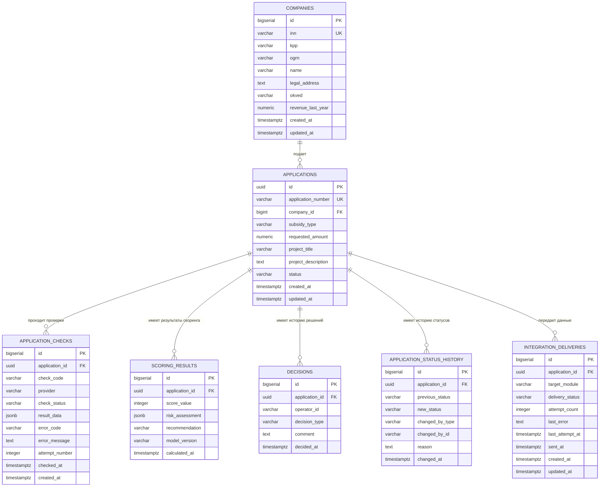

# ER-диаграмма базы данных

## 1. Назначение

ER-диаграмма описывает основные сущности PostgreSQL для Модуля 1 системы «ГИС Господдержка», их атрибуты и связи.

Модель поддерживает хранение сведений о предприятиях и заявках, результатов проверок, скоринга, решений оператора, истории статусов и результатов интеграционного взаимодействия со смежными модулями.

## 2. Диаграмма сущностей

## 3. Описание сущностей

| Сущность | Назначение |
|---|---|
| `COMPANIES` | Профили предприятий и сведения, используемые при заполнении заявки |
| `APPLICATIONS` | Заявки на государственную поддержку, их суммы, описание и текущий статус |
| `APPLICATION_CHECKS` | Результаты отдельных проверок, источники данных, ошибки и повторные попытки |
| `SCORING_RESULTS` | История расчётов скоринга и рекомендаций |
| `DECISIONS` | История решений оператора и основания решений |
| `APPLICATION_STATUS_HISTORY` | История переходов заявки между статусами |
| `INTEGRATION_DELIVERIES` | Состояние передачи данных в Модули 2 и 3, количество попыток и ошибки |

## 4. Основные связи и ограничения

- Одно предприятие может иметь несколько заявок.
- Для одной заявки может выполняться несколько проверок, в том числе повторных.
- Для одной заявки может сохраняться несколько результатов скоринга.
- Для одной заявки могут фиксироваться несколько решений и переходов статуса.
- Для одной заявки могут создаваться записи доставки данных в разные смежные модули.
- ИНН предприятия и номер заявки должны быть уникальны.
- Результаты проверок, скоринга и решений сохраняются с привязкой к конкретной заявке.

## 5. Примечания к модели

1. Текущий статус хранится в `APPLICATIONS.status`; история переходов хранится отдельно.
2. Ошибки внешних сервисов сохраняются в `APPLICATION_CHECKS`, а не интерпретируются как отрицательный результат проверки.
3. Результат скоринга хранится отдельно от окончательного решения оператора.
4. Повторная отправка данных в смежный модуль обновляет состояние интеграционной доставки, а не создаёт повторную бизнес-операцию.
5. Структура не задаёт автоматически сроки хранения записей: они должны быть согласованы отдельно.