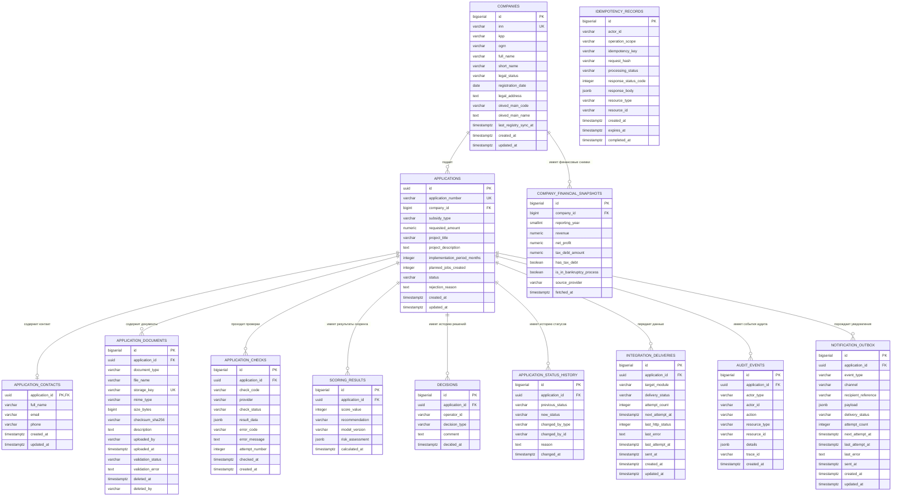

# ER-диаграмма базы данных

## 1. Назначение

ER-диаграмма описывает структуру хранения данных Модуля 1 системы «ГИС Господдержка». Модель согласована с `system-requirements.md` и учебным контрактом `docs/03-api/openapi.yaml`.

Диаграмма покрывает профиль предприятия, финансовые снимки из внешнего источника, заявки и контактные данные, документы, историю проверок и скоринга, решения, историю статусов, интеграционные доставки, ключи идемпотентности, аудит и очередь уведомлений.

## 2. ER-диаграмма

## 3. Сущности и назначение

| Сущность | Назначение |
|---|---|
| `COMPANIES` | Профиль юридического лица, основные сведения из реестра и дата последнего обновления |
| `COMPANY_FINANCIAL_SNAPSHOTS` | Снимки финансовых показателей, полученных из внешнего источника; текущие проверки по заявке дополнительно фиксируются в `APPLICATION_CHECKS` |
| `APPLICATIONS` | Черновик или заявка, сумма, данные проекта и текущий бизнес-статус |
| `APPLICATION_CONTACTS` | Контактные данные заявителя для конкретной заявки; запись может отсутствовать у незаполненного черновика |
| `APPLICATION_DOCUMENTS` | Метаданные файлов, ссылка на защищённое хранилище, результат проверки файла и признаки логического удаления |
| `APPLICATION_CHECKS` | Результаты проверок, источник, ошибки и номер попытки |
| `SCORING_RESULTS` | История оценок, рекомендаций и аналитических атрибутов скоринга |
| `DECISIONS` | История решений оператора, включая возврат на доработку |
| `APPLICATION_STATUS_HISTORY` | История смены бизнес-статусов и субъектов, которые инициировали переход |
| `INTEGRATION_DELIVERIES` | Состояние передачи данных в Модуль 2 и Модуль 3, ошибки и повторные попытки |
| `IDEMPOTENCY_RECORDS` | Защита операций от дублирования при повторных HTTP-запросах с тем же ключом |
| `AUDIT_EVENTS` | Журнал значимых действий, которые не исчерпываются сменой статуса или решением |
| `NOTIFICATION_OUTBOX` | Очередь уведомлений заявителю и история попыток доставки |

## 4. Основные правила модели

1. Одно предприятие может иметь несколько заявок; ИНН предприятия и номер заявки уникальны.
2. Черновик может быть неполным. Для статусов, отличных от `DRAFT`, должны быть заполнены обязательные поля заявки.
3. У заявки может быть ноль или одна текущая запись контактных данных. История бизнес-изменений фиксируется аудиторскими событиями; версионирование самих контактных данных отдельно не предусмотрено.
4. У заявки может быть несколько документов, проверок, скоринговых результатов, решений и событий смены статуса.
5. `APPLICATIONS.status` хранит только бизнес-статус: `DRAFT`, `SUBMITTED`, `DATA_CHECK`, `NEEDS_REVISION`, `UNDER_REVIEW`, `APPROVED`, `REJECTED`.
6. Рекомендация скоринга (`APPROVE`, `MANUAL_REVIEW`, `REJECT`) не является статусом заявки.
7. Техническая ошибка внешнего сервиса хранится как `APPLICATION_CHECKS.check_status = ERROR`, а не как стоп-фактор.
8. Передача данных и уведомления имеют собственный статус доставки и не изменяют уже принятое решение по заявке.
9. Файлы размещаются во внешнем защищённом хранилище. В PostgreSQL сохраняется `storage_key`, контрольная сумма и метаданные, но не бинарное содержимое.
10. Удаление документа через API реализуется логически: запись помечается `deleted_at` и `deleted_by`; обычные запросы списка исключают помеченные документы.
11. Ключи идемпотентности ограничены областью операции и субъектом; срок хранения определяется настройками очистки.
12. `AUDIT_EVENTS.details` не должен содержать пароли, токены, бинарное содержимое файлов или избыточные персональные данные.

## 5. Примечания по реализации

- История статусов, решение и связанное событие аудита должны записываться согласованно в одной транзакции.
- Значения `APPLICATIONS.rejection_reason` должны обновляться вместе с решением `REJECTED`; источником полной истории оснований остаётся `DECISIONS`.
- На уровне приложения/сервиса валидируется контрольное число ИНН и принадлежность ОКВЭД к допустимому перечню учебной программы. Простая проверка длины ИНН в SQL не заменяет контрольное число.
- Ограничения по допустимому типу и максимальному размеру файла должны быть конфигурируемыми после утверждения политики. Значение лимита пока не фиксируется в модели БД.
- `CREATE TABLE IF NOT EXISTS` не обновляет уже существующие таблицы. Для существующей БД нужно подготовить и применить миграцию; данный DDL предназначен для создания схемы с нуля.
